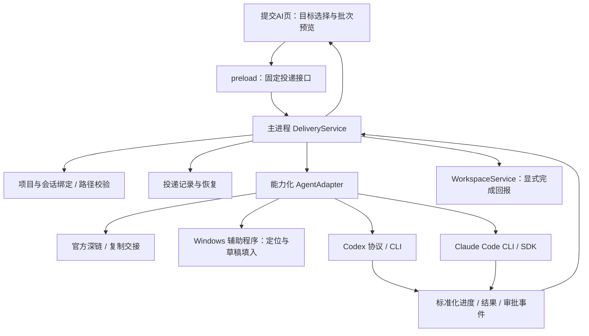

# “提交AI”页向 Codex / 其他 Agent 投递需求：方案与技术架构

研究日期：2026-10-09。范围：当前 Electron 桌面版，仅研究和文档，不修改业务代码、不发送需求、不启动 Agent 执行任务。

## 1. 结论与推荐

可以实现，但必须先区分三个产品动作：

1. **填入输入框**：打开目标应用、定位目标项目与聊天，将 Prompt 放入草稿，用户在目标应用发送。
2. **发送到会话**：将 Prompt 投递到指定聊天或任务，可能立即执行，也可能排队；不经过输入框。
3. **在项目目录运行 Agent**：ReqFlow 启动 CLI / app-server，运行结果回到 ReqFlow；不等于进入用户已有的桌面聊天。

用户当前目标最贴近第 1 项。不能用“在目录启动 codex exec”冒充“填入 Codex 对应项目的输入框”。

建议采用 **项目绑定 + 能力化适配器 + 独立投递记录** 的架构，提供“填入 Agent”和“发送并执行”两个明确入口。第一阶段围绕桌面草稿交接：Cursor 使用官方深链；Codex 先验证 Windows UI Automation 能否稳定识别项目、聊天与输入框，失败降级为复制并引导打开应用。Codex 会话直投作为另一条独立能力验证，不作为预填输入框的替代承诺。

长期如果更重视一键执行、过程跟踪和结果回写，使用 Codex app-server 与 Claude Code CLI / SDK；ReqFlow 保留需求管理，适配层承担执行生命周期。

## 2. 项目现状与接入点

| 文件 / 功能 | 当前行为 | 对本需求的影响 |
| --- | --- | --- |
| `src/renderer/App.tsx:178` 的 `generate()` | 先执行领域 `generate`，再执行 `submit`，随后复制 Prompt | GUI 生成后已经把需求标为执行中，尚未发生真实外部投递 |
| `App.tsx:196` 的 `submitItem()` | 实际调用 `complete`，进入待验证 | 当前“提交AI”是完成回报，不是发送按钮 |
| `App.tsx:202` 的 `completeBatch()` | 将全部执行中需求逐条转入待验证，不限当前批次 | 不能让单次 Agent 完成事件复用这个函数 |
| `App.tsx:230` 的 `copyText()` | 使用 `navigator.clipboard.writeText` | 已有人工交接降级路径 |
| `src/core/domain.ts` 的 `Project.dir` | 关联本地目录 | 可以作为工作目录默认值，但不代表外部应用项目 ID |
| `domain.ts` 的 `Batch` | Prompt 文本、SHA-256、需求版本快照、引导词版本 | 应按批次投递，不临时重新拼接 Prompt |
| `src/renderer/api.ts`、`src/preload/index.ts` | 类型桥和固定 IPC 通道 | 适合新增受限的投递 API |
| `src/main/ipc.ts` | 主进程文件 / Git 操作；外链仅允许 HTTP(S) | 深链要增加专用通道，现有 `openExternal` 无法打开 `cursor://` |
| `src/core/service.ts`、`storage.ts` | GUI / CLI 共用 JSON 工作区 | 投递过程与高频日志应独立于需求状态 |
| `scripts/build.mjs`、`electron-builder.yml` | main/preload 打包、asar 分发；没有生产 dependencies | 原生辅助程序或 SDK 会增加打包、升级与兼容工作 |

现有 `stale` 检查比较需求版本和引导词版本，适合投递前校验。批次已经取消、需求已退回 / 删除 / 归档时，还要补充状态校验。

还发现一个文档边界：`batch show --out prompt.md` 当前 CLI 实际写出的仍是 JSON 响应，Prompt 在 `prompt` 字段中。桥接时应解析 JSON 并提取字段，不能把文件后缀当作内容格式。

本次检查发现仓库已有 README、package.json、renderer 文件的未提交修改；本研究不改动这些内容。

## 3. 已核实能力与未核实边界

### 3.1 Codex

本机只读命令检查：`codex-cli 0.153.0`，支持 `exec`、`app-server`、`queue`、`app-server proxy` 等命令。仅查看 version/help，没有连接现有聊天或执行模型请求。

- **官方集成**：app-server 提供会话与 turn 协议，适合应用集成；它不是桌面输入框操作接口。[Codex App Server](https://learn.chatgpt.com/docs/app-server)
- **轻量运行**：`codex exec` 支持非交互执行，完整 Prompt 可从 stdin 传入；适合作为独立执行后端。[Non-interactive mode](https://learn.chatgpt.com/docs/non-interactive-mode)
- **SDK**：官方 TypeScript SDK 是程序化集成选项，仍需单独验证其会话与桌面应用的可见性关系。[Codex SDK](https://learn.chatgpt.com/docs/codex-sdk)
- **Windows 打开目录**：官方命令参考说明 `codex app PATH` 在 Windows 打印路径，而不是像 macOS 一样打开该工作区。不能据此保证选中指定项目。[Command line options](https://learn.chatgpt.com/docs/cli/reference)
- **待验证候选**：本机 `codex queue --thread <THREAD> --message <TEXT>` 的帮助说明可给既有会话排队。没有实际投递验证，不能保证它能触达当前桌面聊天、唤醒空闲任务、处理不同历史格式，或在桌面显示相同队列。
- **待验证候选**：本机 `app-server proxy` 可转发到运行中的 control socket；需要先确认 Windows transport、服务归属、客户端连接权限和协议版本。不能直接假设它就是桌面应用开放的控制端口。
- **未确认**：本次查阅没有确认到“外部应用指定 Codex 桌面项目 / 聊天并预填草稿”的公开稳定接口。不能编造 `codex://new?...prompt=...` 链接。

当前聊天环境中有创建聊天、给聊天发消息等 Codex 工具。它们是宿主向 Agent 提供的能力，并不自动成为 ReqFlow 能调用的 HTTP / IPC API。也不能把工具 schema 复制到 ReqFlow 就视为集成完成。

### 3.2 Claude Code

本机版本 `2.1.212`；help 已确认 `--print`、JSON / stream-json 输出、stream-json 输入、`--resume`、`--session-id` 等选项。

官方支持程序化运行和 session ID 续聊，适合在绑定目录中执行并回传结果。它不等于填入 Claude 桌面或 IDE 的现有输入框。[Run Claude Code programmatically](https://code.claude.com/docs/en/headless)

本机版本比当前文档部分特性的最低版本旧；例如文档标注 `--permission-prompts` 需要 2.1.259，跨目录按 ID 恢复的行为在 2.1.223 前也不同。适配器必须按安装版本选择参数，不能直接照搬最新示例。本机先限定同一 cwd 内恢复会话。

### 3.3 Cursor

官方提供 Prompt 深链：

```text
cursor://anysphere.cursor-deeplink/prompt?text=<URL编码的Prompt>
```

可以预填聊天，用户确认后执行；编码后的链接上限为 10,000 字符。文档未提供这个 Prompt 深链精确绑定某个本地目录 / 已有聊天的保证，因此项目窗口选择仍需验证。中文批次编码后容易超长，必须检查实际完整 URL 长度，超限降级复制。[Cursor Deeplinks](https://prod.cursor.com/docs/reference/deeplinks)

### 3.4 Windows UI Automation

UI Automation 可识别桌面控件、读取属性并操作可访问性树。适合跨应用草稿填入，但目标应用是否暴露可写输入框、可读项目路径仍需本机 PoC。控件定位优先于固定屏幕坐标。[Microsoft UI Automation Overview](https://learn.microsoft.com/en-us/dotnet/framework/ui-automation/ui-automation-overview)

不要把 React/Electron 应用都默认视为可稳定自动化；自绘控件、contenteditable 和可访问性开关会影响结果。

## 4. 方案对比

| 方案 | 精确填入已有输入框 | 指定项目能力 | 结果回传 | 稳定性 / 成本 | 定位 |
| --- | --- | --- | --- | --- | --- |
| 复制 + 引导打开应用 | 用户手动粘贴 | 用户确认 | 人工 | 高 / 低 | 必备降级 |
| 官方 Prompt 深链 | Cursor 支持；Codex 未确认 | 单独验证窗口选择 | 通常无 | 接口内较高 / 低 | 优先采用已公开能力 |
| Windows UI Automation | 有条件可实现 | 必须可靠核对项目 / 聊天 | 草稿回读为主 | 中低 / 中高 | 满足桌面输入框目标 |
| Codex queue / 共享服务 | 不填输入框，排队 / 会话投递 | thread ID + cwd 校验，尚待验证 | 尚待验证 | 未定 / 中 | Codex 专项 PoC |
| ReqFlow 启动 app-server | 不填输入框，直接发 turn | 明确 cwd、持久化 thread ID | 可集成事件 | 协议变动需适配 / 中高 | 长期执行集成 |
| Codex exec / Claude print | 不填输入框，执行任务 | 子进程 cwd + session ID | JSON / 流输出 | 较高 / 中 | 快速执行后端 |
| IDE 扩展桥 | 可由扩展对接支持的接口 | 可检查工作区 | 取决于开放 API | 需维护 / 高 | 目标 IDE 确定后考虑 |
| ReqFlow MCP / 文件收件箱 | Agent 主动领取，不能自动预填 | 显式 projectId | 可设计回报工具 | 较高 / 中 | 辅助集成 |

不建议作为基础架构：固定坐标点击、直接改 Codex 私有数据库 / rollout 文件、自动开启 Chromium 调试端口注入 DOM、模拟输入后盲按 Enter。

## 5. 建议架构



### 5.1 职责边界

- Renderer：展示项目、批次、目标聊天、投递模式与回执；不运行 shell，不持有凭据。
- Preload：固定参数结构，不暴露任意进程执行和任意深链打开。
- DeliveryService：重新读取当前批次、校验绑定、持久化意图、调用适配器、归一化状态。
- Adapter：声明真实能力，例如 `prefill`、`newSession`、`resumeSession`、`queue`、`stream`、`cancel`、`interactiveApproval`。不支持的能力在 UI 禁用，不能静默换成执行模式。
- Windows 辅助程序：建议小型 .NET 可执行文件，使用 UI Automation；JSON stdin/stdout 通信，由主进程管理，随安装包分发。
- Domain：继续负责需求与批次状态；不混入窗口坐标、Agent RPC、进程控制。

建议未来接入文件：`src/main/agents/`、`src/main/delivery/`、`src/core/delivery-types.ts`，以及现有 App / api / preload / ipc 的受限扩展。本次不创建这些代码文件。

### 5.2 绑定模型

每个 ReqFlow 项目可保存多个 `AgentBinding`，其中一个为默认目标：

| 字段 | 用途 |
| --- | --- |
| `id`、`provider`、`transport` | 区分 Codex 桌面、Codex CLI、Claude Code、Cursor 等目标 |
| `hostId`、`cwd` | 机器与实际目录；首版仅 local，本地不能直接代表 WSL / SSH / 云端目录 |
| `externalProjectId` | 外部应用确实提供时保存，不能用 ReqFlow projectId 代替 |
| `sessionPolicy`、`sessionId` | 新建 / 复用指定聊天；不默认“最近一个聊天” |
| `mode` | `prefill` / `send`，默认 prefill |
| `windowHint`、`lastVerifiedAt` | UI 定位提示与验证时间；窗口句柄不能作为永久主键 |
| `permissionProfile`、`executableRef` | 执行权限和本机程序配置引用 |

路径比较使用绝对路径、realpath 和 Windows 适当的大小写规则；junction / symlink 要解析。Git 同仓库的两个 worktree 目录不能混为同一目标。用户只提供项目名且有重名时必须选择具体目录与聊天。

GUI 项目目录 `Project.dir` 可作为首次绑定默认值。之后目录变化应使旧绑定失效或要求重新核对，不应偷偷把既有聊天改到新目录。

### 5.3 投递记录

`Delivery` 保存：`id`、`projectId`、`batchId`、`bindingId`、`mode`、`promptHash`、需求 ID / 版本快照、绑定快照、attempt、时间、状态、回执、external session / turn ID、错误。

建议状态：

```text
prepared → delivering → prefilled
                     → accepted → queued / running → completed / failed / interrupted
                     → unknown
prepared / delivering → failed（能够确定未投递）
```

“协议调用返回成功”“UI 填入成功”“Agent 开始执行”“需求实现完成”分别记录。深链被操作系统接受只能说明 handoff 已发起，不能直接记为 `prefilled`；没有草稿回读时显示“已打开，待确认”。

防重以 `projectId + batchId + promptHash + bindingId + mode + sessionPolicy` 为默认键，并保存本次具体 session ID。双击复用正在投递的记录；“再次发送”显式生成新 attempt。不同批次即使同文本也不要自动合并。

外部接口不一定支持幂等。发送后超时 / 崩溃可能已被接收，必须进入 `unknown`，查询会话证据或让用户核对后再重发；不能声称实现 exactly-once。

### 5.4 存储与并发

第一阶段建议独立本地投递账本和日志目录：低频状态采用原子快照，由 GUI 主进程单写；流日志按 delivery ID 追加，定期清理。项目绑定通过工作区领域操作保存，机器专属程序路径 / 凭据引用保存在本机配置。

重要限制：现有 `WorkspaceStore.write()` 是“读版本 → 检查 → 写临时文件 → rename”，不是跨进程原子 compare-and-swap。两个进程可能同时通过版本检查后相互覆盖；原子 rename 只保证文件完整性。现有 README 中的并发表述不能作为投递幂等保障。

因此异步完成回写先交给单一主进程处理，仍需防 GUI / CLI 同时写工作区。若后续允许 CLI、多个窗口、MCP 服务写投递账本，应采用统一写服务 + 跨进程锁，或事务型数据库；这属于后续实现设计，不在本次修改范围内。

## 6. 输入框填入路线的具体流程

1. 用户在“提交AI”页选择批次、目标 Agent 和绑定聊天，默认“填入，手动发送”。
2. 主进程重新校验批次、hash、需求版本、项目目录和目标能力，落盘 prepared。
3. 对已支持官方预填的应用生成固定模板深链，先检查编码长度；不要通过 HTTP 跳转页传输私有需求。
4. Codex UI 路线先定位正确进程及窗口，再核对可观察的项目 / 目录和聊天。无法证明目标一致就停止自动填入，降级交接。
5. 输入框已有草稿时不自动清空；提供追加、替换或取消选择。不能在用户输入时抢写。
6. 优先使用可写控件 pattern；不可写时在明确焦点下用剪贴板粘贴，处理多行、中文、IME。可回读时校验内容与 Prompt 一致。
7. 填入成功后停在草稿，不自动按 Enter。若不能可靠回读，回执为“待用户核对”，不能报已验证成功。
8. 复制降级保留完整 Prompt，显示目标项目、目录与建议聊天，由用户粘贴发送。

不要长期保留或回传剪贴板旧内容。若尝试恢复剪贴板，只有序列号表明内容未被用户更新且格式可安全恢复时才恢复；否则保留新 Prompt 并告知。UI 自动化也应避免覆盖用户正在编辑的草稿。

UIA PoC 无法通过项目身份和内容验证时，Codex 的自动输入框功能应标记为暂不支持；不能改用坐标盲填满足验收。

## 7. 会话直投 / 执行路线

### 7.1 Codex

优先评估 ReqFlow 管理的 app-server 子进程，使用 stdio，避免首版开放网络端口。连接、创建 / 恢复、投递、审批、完成的 wire schema 必须从实际安装版本生成或核对，锁定适配版本。

最小生命周期：初始化 → 校验或建立指定 cwd 的 thread → 持久化 thread ID → 发送 Prompt → 保存 turn 回执 → 观察结果。审批请求转为 ReqFlow 可见交互，不能为了消除等待默认关闭权限。独立进程持久化了同一个 thread ID，也不证明桌面应用已选中、实时同步或能安全并发操作该聊天。

对于运行中的聊天，首版在 ReqFlow 排队等待空闲，不自动 steer 或中断。以后确实需要追加当前轮次时再增加明确操作，避免新需求改变正在运行的任务。

轻量备选为 `codex exec --json -C <绑定目录> -`，Prompt 从 stdin 传入；结果按安装版本的事件格式解析。不要将任意用户内容拼入 PowerShell / cmd 命令字符串。

`codex queue` / 共享 daemon 属于独立验证分支：确认桌面会话 ID、cwd、排队回执、空闲唤醒、升级兼容后才能开放。它仍是“排队发送”，不能标为“填入输入框”。

### 7.2 Claude Code

在绑定 cwd 启动 `claude -p`，Prompt 从 stdin 输入；输出可先用 JSON，进阶使用 `--output-format stream-json --verbose`。记录返回的 session ID，后续指定 `--resume <id>`；避免多项目场景使用含糊的 `--continue`。

首版明确授权工具范围并展示权限拒绝和未完成信息；需要交互审批时再采用支持审批回调的 SDK 方案。不能把纯 stream-json 输出理解为已经实现审批交互，也不默认使用 bypass permissions。

### 7.3 Windows 启动程序

本机 PATH 中 Codex、Claude 都存在 npm shim。Electron 的 `spawn` / `execFile` 不能把 `.ps1`、`.cmd` 当成普通原生可执行文件照搬。

适配层应解析并校验安装入口：Codex 可使用实际原生程序，或系统 Node + 已验证的 CLI JS；Claude 本机 shim 指向原生 `claude.exe`。路径需检测，不能固化本次用户目录。尤其 `process.execPath` 在打包 Electron 中是 ReqFlow.exe，不能当作系统 Node 使用。

长 Prompt 优先 stdin，避免命令行长度和引号问题；仅提供 `--message` 的 queue 路线要明确长度限制，超限不能截断。后台子进程设置 `windowsHide`；只有用户选择可见交互终端时才显示窗口。

## 8. 需求状态与界面建议

保留“提交AI”Tab 名称，但动作文案建议区分：

- “生成 Prompt”：产生 / 展示批次。
- “填入 Codex / Cursor”：草稿交接。
- “发送并执行”：明确开始 Agent 任务。
- 当前“提交AI”：改名为“AI 已完成 → 待验证”，避免用户误认发送入口。

第一阶段保持现有生成即执行中的行为，以降低迁移范围，但增加“尚未投递 / 已填入 / 已发送”等独立标记，让 `Batch.status=submitted` 不再被误当作外部回执。后续如调整领域流程，另行设计“生成保持 draft，真正执行或人工确认发送后 submit”的兼容迁移；只填草稿不视为开始执行。

Agent 的 completed 表示一次运行结束，并不保证每条需求满足验收。首版由用户选择哪些需求进入待验证；自动回写应只作用于本次 Delivery 的 ID / 版本集合，不能完成项目全部执行中需求。

旧批次结束、新需求版本已生成时，旧结果只记录在旧投递，不推进新版本。取消批次也不等于停止外部 Agent；需要单独取消运行及回执，UI 清楚展示差别。

## 9. MCP / 插件的适用边界

后续可以将 ReqFlow 现有 CLI 包装为 MCP 工具，供 Agent 读取明确授权的 project / batch、领取投递、回报实现结果。可设计 `get_batch`、`claim_delivery`、`report_result` 等接口。

但一般 MCP 工具由宿主 / Agent 调用；服务端新增工具不会自动让宿主输入框出现文本，也不会自动创建桌面聊天。若用收件箱，需要目标 Agent 已有领取机制或宿主公开的触发入口。

插件如果确实获得宿主聊天控制 API，可以成为额外适配器；在取得文档和可调用权限前不把这种能力当成既有事实。无需为了本次研究安装插件。

## 10. 推荐实施顺序与验证门槛

### 阶段 A：隔离 PoC，先确认目标桌面是否可控

不改 ReqFlow 主流程，用一次性测试项目和短 Prompt 验证，后续实施时再进行真实消息测试：

| 验证项 | 通过标准 / 决策 |
| --- | --- |
| Codex UIA 可访问性 | 能定位正确窗口、可验证项目 / 聊天身份、可写与回读输入框 |
| 两个同名项目 / 多窗口 | 不选错；身份不足时失败并降级 |
| 草稿与用户输入 | 不覆盖已有草稿，不抢写，不自动执行 |
| Cursor 深链 | 预填成功；指定项目窗口的行为独立验证 |
| Codex queue | 在测试会话观察真实回执、队列、空闲 / 忙碌行为和桌面同步 |
| Codex 共享服务 | 只在确认可用 transport 和权限后测试；不修改私有数据库 |
| 长中文与换行 | 链接长度检查、stdin 内容完整；超限可降级 |

A 的结果决定 Codex 桌面是否能提供“自动填入”；失败则第一版只提供复制交接，并明确说明限制。

### 阶段 B：草稿交接 MVP

实现项目绑定、能力检测、批次校验、投递账本、明确的填入按钮、Cursor 深链、通过 PoC 的 Codex UIA 和复制降级。完成按钮文案与投递按钮分开。此阶段无需嵌入完整 Agent 执行 UI。

### 阶段 C：直接执行闭环

新增独立的 Codex / Claude 执行目标、进度和权限交互、明确会话 ID、完成结果关联。优先验证事件与版本兼容，再决定 app-server 或 CLI 的首版范围。

### 阶段 D：扩展与稳健性

增加其他 IDE 扩展、MCP 收件箱、远程 host / worktree 绑定、多进程事务存储。不能在只有项目名称的情况下跨机器自动匹配。

## 11. 后续实现验收场景

1. 相同项目名、不同目录和 worktree 都投递到正确目标；找不到可靠身份时停止。
2. 双击只产生一次投递；显式再次发送保留新 attempt 与旧回执。
3. 生成后修改需求 / 引导词、取消批次或删除目标项目，发送前能发现。
4. 外部已接收而 ReqFlow 崩溃，重启呈现 unknown，不能自动重复执行。
5. 草稿填入后不发送、不提前标为 Agent 完成；已有草稿不会被覆盖。
6. Agent 忙碌时新批次按明确策略排队，绝不偷偷 steer 当前工作。
7. 单次 Agent 结束不推进无关需求，新版本不被旧批次回写。
8. CLI 未安装、登录失效、目录移动、升级不兼容均给出具体错误及复制降级。
9. 打包安装版、便携版和中文 / 空格路径下均能发现实际 Agent 程序；不依赖开发机 PATH 的偶然配置。
10. GUI 与 CLI 并发修改不会因新增投递链路覆盖工作区；需要锁 / 单写服务的验证。

本次已完成源码与官方文档核对、安装 CLI 帮助核对。**尚未进行 UIA、深链、真实会话投递、模型执行或打包 PoC**，以上验收属于未来实现的验证要求。

## 12. 决策摘要

- 若要求“需求进入已有桌面输入框，自己点发送”：先做官方预填能力 + Codex UIA PoC，复制交接兜底。
- 若要求“需求到指定项目立刻执行，能看结果”：优先设计 Codex app-server / Claude CLI 适配器，执行入口与草稿入口分开。
- 若要求“进入现有 Codex 桌面聊天并可排队”：专项验证本机 queue / 共享服务，成功后作为版本限定能力开放。
- 无论采用哪条路线，都应先解决项目与聊天的精确绑定，以及当前“提交AI”完成按钮的语义混淆。
