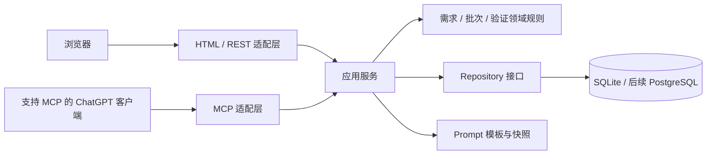

# 架构设计

## 总体选择

采用 Go 模块化单体，单个进程提供网页、REST API 和可选 MCP 接口。优先服务个人与小团队，避免为 MVP 引入微服务、消息队列和复杂前端构建。Web 使用 Go HTML 模板与 HTMX，少量原生 JavaScript处理编辑器、自动保存和复制。

两个入口复用相同应用服务、权限检查和事务逻辑。MCP 不直接操作数据库，也不复制状态转换规则。

## 模块职责

| 模块 | 职责 |
| --- | --- |
| project | 项目资料、成员权限、引导词版本 |
| requirement | 类型、状态、验收条件、排序与乐观锁 |
| prompt | 模板、预览、不可变快照、提交批次 |
| verification | 验证记录、失败回流、完成条件 |
| auth | 浏览器会话、MCP 身份、项目访问权限 |
| audit | 修改、状态转换、批次提交与验证审计 |

## 核心数据模型

- `projects`：ID、owner_id、名称、说明、时间。
- `project_members`：项目、用户、角色，个人版仅 owner；远程访问时也不能省略归属校验。
- `guidance_versions`：项目、版本、正文、创建人、时间；新版本追加保存。
- `requirements`：ID、项目、项目内编号、类型、状态、标题、正文、优先级、sort_key、version、时间。
- `acceptance_criteria`：ID、需求、内容、是否必需、排序。修改验收条件同样增加需求 version。
- `requirement_revisions`：需求、版本、正文与验收条件快照、修改人、时间。
- `prompt_batches`：项目、模式、草稿/已提交/已取消、引导词版本、模板版本、完整文本、SHA-256、提交时间。
- `prompt_batch_items`：批次、需求、源版本、完整需求快照、顺序。快照不能依赖可变正文。
- `execution_links`：批次或需求、PR/commit/会话链接、说明。
- `verification_runs` 与 `verification_results`：需求及受测版本、环境、结果、逐项证据、操作者、时间。
- `audit_events`：项目、对象、操作、旧/新状态、操作者、请求 ID、时间。

使用 UUID 或 ULID 作为内部 ID，用 `REQ-001` 作为项目内可读编号，数据库唯一约束 `(project_id, number)`。时间存 UTC，界面按用户时区显示。关系外键启用；不可变历史不级联删除。

## 关键一致性规则

自动保存携带 expected_version，更新语句包含 `WHERE version = ?`，成功后 version 加一；不匹配返回 409。正文、验收条件、修订历史在同一事务内更新。

生成批次在一致的读取事务内取得引导词和需求快照。提交批次在一个写事务里检查批次尚未提交、权限、源版本、需求为 ready，并将需求改为 in_progress。两个批次并发提交同一条需求只能有一个成功。明确提交旧快照时记录执行版本，后续修改标记为未提交修订，不能假定新版本已完成。

完成实现转入待验证时关联具体执行批次和版本。验证通过只适用于对应执行版本；若当前需求或验收条件已变化，不能直接将当前版本标记为 verified。失败结果与回流在一个事务内写入。

删除默认使用归档。被批次引用的需求只能归档，历史仍可查看；项目删除先提供导出并按明确保留策略处理。

## 编辑与交互

需求列表、编辑区、Prompt 预览组成工作区。编辑防抖约 800ms 自动保存，离开前刷新未保存内容；浏览器本地暂存仅作失败恢复，不替代服务端确认。冲突时显示两份内容供合并。MVP 用分页和显式刷新，不引入 WebSocket；后续有协作需求再考虑 SSE。

复制使用 Clipboard API，权限失败则提供选中文本和下载 `.md`。服务端渲染 Markdown 时禁用原始 HTML并清理链接，所有普通模板输出使用默认转义。
